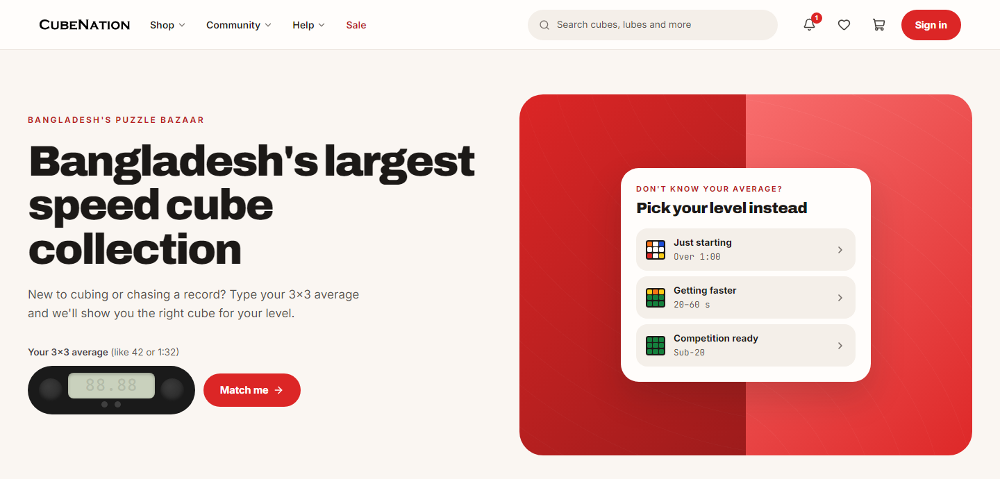
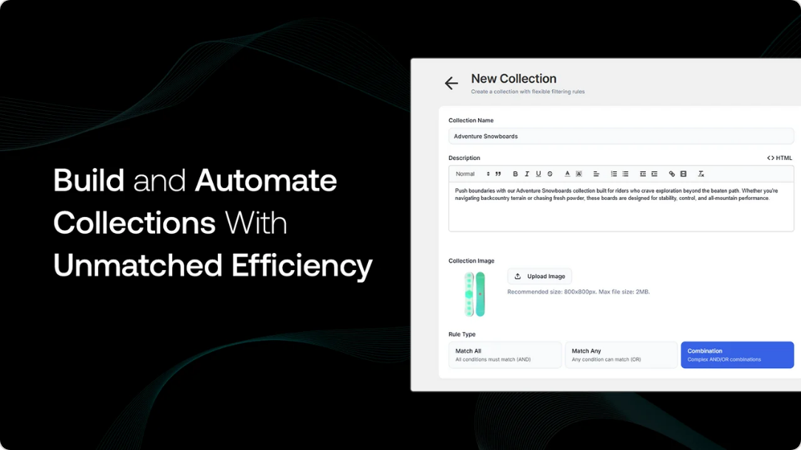
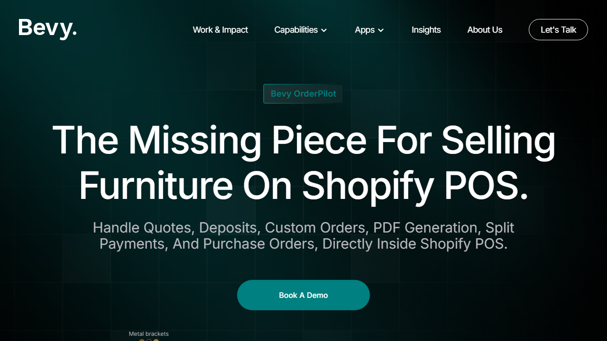
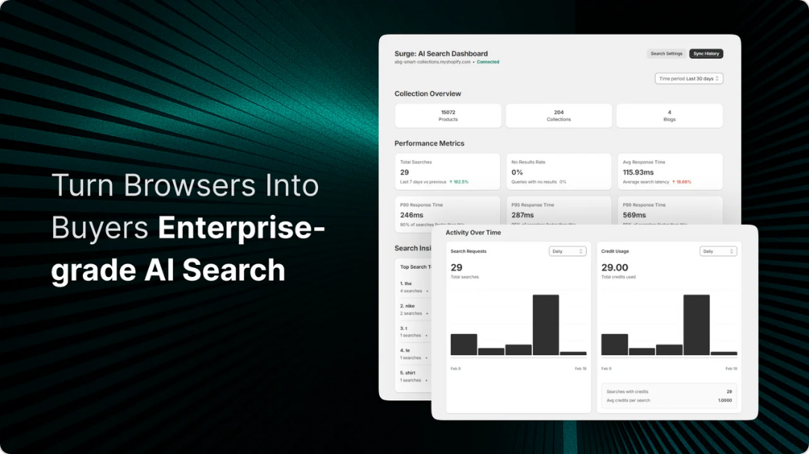
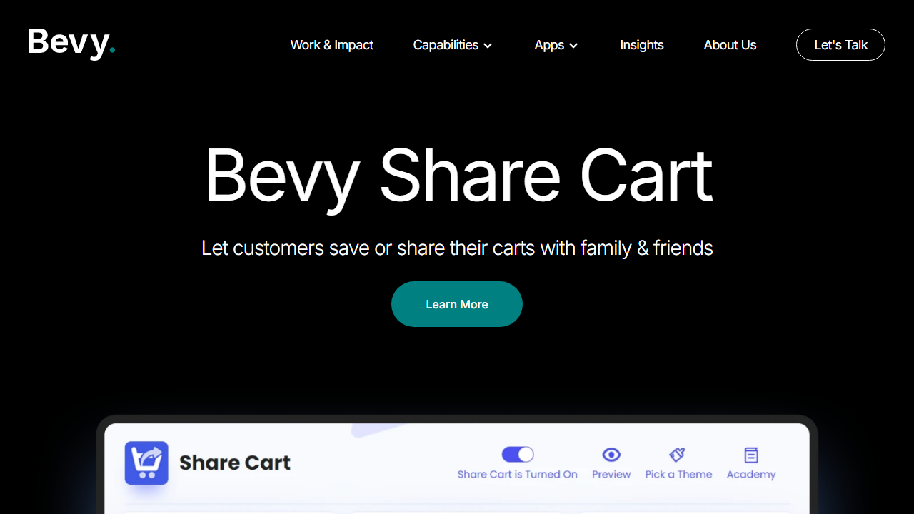

# Farhanul Haque Khan

**Founder and product manager.** I build commerce products from 0 → 1: my own store, and Shopify apps used by brands like Reebok and Champion.

[LinkedIn](https://linkedin.com/in/farhanulkhan) · [Email](mailto:2017khan54@gmail.com) · [Résumé](https://github.com/farhanulju/Resume-PDF/blob/main/resume.pdf) · Dhaka, Bangladesh

I started CubeNation at 16 and still run it. It's where I learned product the honest way: every call on pricing, checkout and stock showed up in next month's revenue. I bring that same lens to my work as Product Manager at Bevy Commerce, where I've launched 8 Shopify apps as the sole PM.

## CubeNation

**Bangladesh's largest store for speedcubing puzzles.** Founded in 2016, grown from nothing into a profitable, multi-channel business with a team of 8.

- **15,000+ customers** and **4,400+ monthly active users**
- Redesigned the checkout flow: **+37% conversion** in 2025
- Rebuilt the supply chain around stockouts: **+18% revenue** in FY 24–25
- Grew the market, not just the store: a mentorship program that coached **200+ students** (72% completion) and helped 16 organizers launch national competitions, plus booths at **18 events with 60,000+ attendees**

→ [cubenationshop.com](https://www.cubenationshop.com/)

## Shipped at Bevy Commerce

Each of these started as an enterprise merchant's problem that Shopify couldn't solve out of the box.

<table>
<tr>
<td width="50%" valign="top">

<h3><a href="https://apps.shopify.com/smart-collections-builder">Smart Collections Builder</a></h3>
Shopify's collections can't filter on metafields or mix AND/OR rules, so big catalogs were curated by hand. Now used by Reebok, Champion, Juicy Couture and Authentic Brands Group, it saves <b>1,200+ work hours per quarter</b>.
</td>
<td width="50%" valign="top">

<h3><a href="https://www.bevycommerce.com/order-pilot/">OrderPilot</a></h3>
Furniture retailers with custom configurations couldn't run on SKU-based Shopify. OrderPilot builds the product at the point of order and replaces their signing, PO and inventory tools. It brought <b>6+ merchants with $40M+ annual revenue each</b> onto Shopify for the first time.
</td>
</tr>
<tr>
<td width="50%" valign="top">

<h3><a href="https://apps.shopify.com/surge-ai-search">Surge: AI Search</a></h3>
A drop-in replacement for Shopify's native search, with NLP-powered instant results, reliable typo tolerance, personalized recommendations and a search UI that fits any theme.
</td>
<td width="50%" valign="top">

<h3><a href="https://www.bevycommerce.com/share-cart">Share Cart</a></h3>
Turns a live cart into a shareable link for families, corporate wishlists and one-click bundles. Repackaging it into usage-based tiers per customer segment <b>grew MRR by 80%</b>.
</td>
</tr>
</table>

Also launched: [Bevy Price Rules](https://apps.shopify.com/bevy-price-rules) · [Bevy Affiliate](https://apps.shopify.com/bevy-affiliate-marketing)

**Across the portfolio:** 120% ARR growth and 30% lower OpEx from structured A/B testing, plus a training program that upskilled 50+ staff and helped Bevy earn **Shopify Premier Partner** status.

## How I work

- **Revenue is the scoreboard.** Running my own business means every feature has a P&L attached, and I hold roadmaps to the same standard.
- **Instrument before you iterate.** I set up the Sentry, PostHog and Metabase stack across Bevy so we catch issues before customers report them.
- **AI in the MVP, not on the roadmap.** Building AI in from the first prototype has cut **4+ weeks** off each launch cycle.
- **Show, don't spec.** I prototype working versions myself, so engineers and stakeholders react to something real instead of a document.

## Currently

Advisor to the board of **Speedcubing Bangladesh**, where I'm also building its new platform: competitions, national records and registration, synced daily from the World Cube Association. *Work in progress* · [repo](https://github.com/farhanulju/Speedcubing-Bangladesh)

## Compare notes

I enjoy trading ideas with founders and teams working on:

- taking a Shopify app or SaaS product from idea to first paying customers
- improving checkout and conversion for a growing online store
- setting up analytics so product decisions stop being guesses

If that sounds like you, [say hello](mailto:2017khan54@gmail.com?subject=Hello%20from%20GitHub).

Off the clock: speedcuber ([WCA profile](https://www.worldcubeassociation.org/persons/2017KHAN54)) and chess player.
